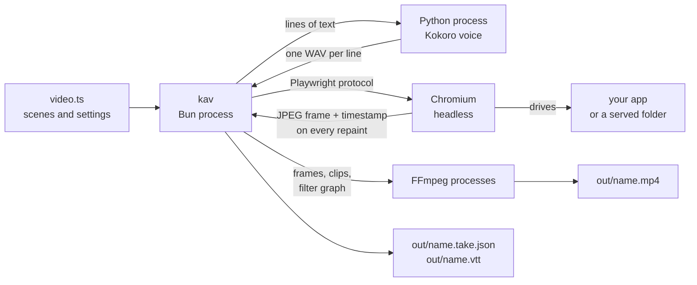
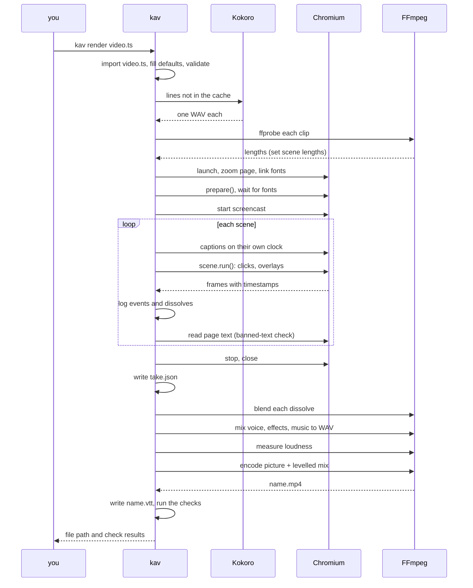
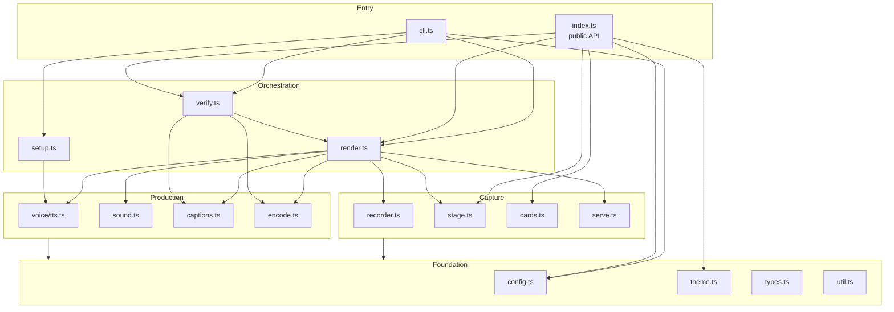
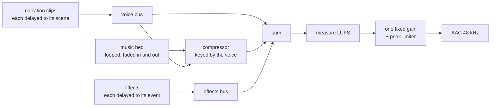

# Architecture

How the kit is put together: the processes involved, the modules, the data that flows
between them, and where it can be extended. For the pipeline told as a story, read
[How it works](how-it-works.md) first. For the tools and their versions, see
[Tech stack](tech-stack.md).

## The system in one picture



Four kinds of process take part, and only one of them is ours:

| Process | Started by | Lives for | Does |
|---|---|---|---|
| **kav** (Bun) | you | the whole render | Everything in `src/`: orchestration, timing, logs |
| **Python** (Kokoro) | kav, once per render | until the new lines are voiced | Text to WAV |
| **Chromium** | kav, through Playwright | the recording | Runs the app, paints overlays, hands back frames |
| **FFmpeg / ffprobe** | kav, several times | each a few seconds | Measures clips, makes sounds, blends dissolves, mixes, encodes |

kav talks to the others only through their command lines, standard input and files.
Nothing is linked in, which is why each can be replaced.

## One render, step by step



## Layers



Dependencies point downwards only. The rules that keep it that way:

- **Foundation** knows nothing about browsers or FFmpeg. `types.ts` holds every shared
  shape; `util.ts` holds the one function that starts a process.
- **Capture** modules talk to the page. They never start FFmpeg.
- **Production** modules talk to FFmpeg and Python. They never touch the page.
- **Orchestration** is the only layer that knows the order of things.
- A **video file** imports only from `index.ts`.

## Modules

| Module | Lines (about) | Responsibility | Talks to |
|---|---|---|---|
| `cli.ts` | 100 | Parse the command, call one orchestration function, print | terminal |
| `index.ts` | 15 | The public API a video file imports | none |
| `config.ts` | 50 | `defineVideo`; fill defaults; refuse mistakes early | file system (import) |
| `types.ts` | 115 | Every shared type: `VideoConfig`, `Scene`, `Take`, `Frame`, `Cue`, `Dissolve` | none |
| `theme.ts` | 50 | Colours, font stacks, easing curves; merge a partial theme | none |
| `util.ts` | 35 | `run` (start a process), `sleep`, `esc`, the cache folder | processes |
| `render.ts` | 140 | The runner: narration, browser, scene loop, take, finish, remix | all of capture and production |
| `recorder.ts` | 70 | Zoom the page, link and await fonts, write frames with timestamps | Chromium |
| `stage.ts` | 260 | Pointer, captions, spotlight, camera, dissolves, chapters, full-screen layers | Chromium |
| `cards.ts` | 125 | HTML for hook, title, steps and end cards | none (returns strings) |
| `serve.ts` | 35 | A static file server for `serve` | network (localhost) |
| `voice/tts.ts` | 60 | Cache key per line; run Kokoro; measure clips; draft estimates | Python, ffprobe |
| `voice/kokoro_tts.py` | 25 | Text to WAV with kokoro-onnx | Kokoro model |
| `sound.ts` | 100 | Effects per event kind; the generated music bed | FFmpeg, soundcn |
| `captions.ts` | 65 | Split a line into captions; WebVTT | none |
| `encode.ts` | 150 | Plan and blend dissolves; build the mix; level it; encode | FFmpeg |
| `verify.ts` | 100 | The checks | ffprobe, FFmpeg |
| `setup.ts` | 80 | `kav setup` and `kav doctor` | Playwright CLI, Python, network |

## The data

### Time

There is one clock: milliseconds since recording started (`Recorder.now()`). Frame
timestamps, caption cues, narration starts, sound events and dissolve marks are all on
it. That single clock is what lets the encoder place a click sound on the frame where
the click happened without anyone lining anything up.

Scene length is decided before recording, from the voice:

```
scene = lead-in (350 ms) + narration clip + pause (800 ms)
        but never shorter than its steps take to run
```

### The take

A recording produces one JSON file, `out/<name>.take.json`. It is the boundary between
the capture half and the production half of the kit.

```ts
interface Take {
  draft: boolean
  frames: { file: string; t: number }[]         // every repaint, in order
  endMs: number                                  // length of the recording
  audio: { file: string; at: number }[]          // narration clips and their start times
  cues: { text: string; start: number; end: number }[]   // captions
  events: { t: number; kind: 'click' | 'callout' | 'whoosh' }[]   // where sounds go
  dissolves: { t1: number; t2: number; ms: number }[]    // changes of screen
  seen: { id: string; text: string }[]           // page text per scene
  missingFonts: string[]
}
```

Everything after the take is a pure function of it plus the settings. That is why
`kav remix` can change the music or the effects in seconds, and why `kav verify` can
check a render without opening a browser.

### A dissolve, in detail

`stage.dissolve(fn)` records `t1` just before `fn` and `t2` just after. Nothing special
happens in the page: the loading state is filmed like anything else. The work is in the
encoder (`planDissolve`, `blendDissolves`):

```
recorded:   A A A A | L L L L L L L L | B B B B        L = loading, whatever was filmed
                    t1                t2
encoded:    A A A A A A A A A A A x x x B B B B        x = A blended into B, the last 380 ms
```

1. `A` is the last frame at or before `t1`; `B` is the last frame at or before `t2`.
2. Every frame between them is dropped.
3. FFmpeg's `xfade` makes the blended frames from `A` and `B`.
4. They are placed in the last `ms` before `t2`, so `A` simply holds until then.

### Files on disk

| Where | What | Kept in git |
|---|---|---|
| `<project>/video.ts` | The video | yes |
| `<project>/out/<name>.mp4`, `.vtt` | The result | no |
| `<project>/out/<name>.take.json` | The take | no |
| `<project>/out/frames-<name>/` | One JPEG per repaint | no |
| `<project>/out/blends/` | Blended dissolve frames | no |
| `<project>/out/failed.png` | The page when a render stopped | no |
| `~/.cache/kwartz-ai-video/kokoro/` | The voice model (about 350 MB) | n/a |
| `~/.cache/kwartz-ai-video/kokoro-venv/` | Python environment for the voice | n/a |
| `~/.cache/kwartz-ai-video/audio/` | Narration clips, named by a hash of voice, speed and text | n/a |
| `~/.cache/kwartz-ai-video/sfx/`, `music-pad.wav` | Effects and the music bed | n/a |

The cache is per machine and shared by every project. Set `KAV_HOME` to move it.

## The sound graph

One FFmpeg run builds the mix, a second measures it, a third applies the gain while
encoding the picture.



## Overlays and coordinates

Overlays are HTML that Playwright injects into the page (`page.screencast.showOverlay`),
so they are captured in the same frames as the app. Two facts shape `stage.ts`:

- **Zoom.** The page is zoomed, Playwright reports element boxes in window pixels, and
  overlays are laid out in zoomed pixels. Every box is divided by the zoom before an
  overlay is placed on it (`Stage.box`).
- **Stacking.** Overlays stack in the order they were created. The spotlight dims
  everything under it, so the caption is drawn again after each spotlight to stay on
  top.

The camera does not move a viewport. It applies a CSS `transform: scale()` to the app's
root element, with the origin on the target, so the target stays put and everything
around it grows. Overlays are outside that element and keep their size. The transform
is removed when the camera returns, because a transformed ancestor changes where
fixed-position elements (drawers, dialogs) anchor.

## Where to extend

| To add | Change |
|---|---|
| A new card | A function in `cards.ts` that returns HTML; export it from `index.ts` |
| A new stage move | A method on `Stage`; log an event if it should make a sound |
| A new sound for an event | An entry in `SFX` in `sound.ts`, and the kind in `EventKind` |
| Another voice engine | A function with the shape of `narrate` in `voice/`, chosen by a `voice.engine` setting |
| A new check | A `Check` pushed in `verify.ts`; keep the logic in a pure function with a test (see [Testing](testing.md)) |
| Another transition | A filter other than `xfade=fade` in `blendDissolves` |
| A new output (vertical, GIF) | `layout` for the size; a second encode in `finish` |

## What is deliberately not here

- **No timeline editor and no project format.** The video file is the project.
- **No bundled media or models.** Everything large is downloaded once into the cache.
- **No cloud service.** A render works offline once set up, apart from fonts in the
  default theme.
- **No build step.** Bun runs the TypeScript directly; the package exports its source.
- **No word-level caption timing.** The voice model does not report it; captions are
  timed by their share of the text.
