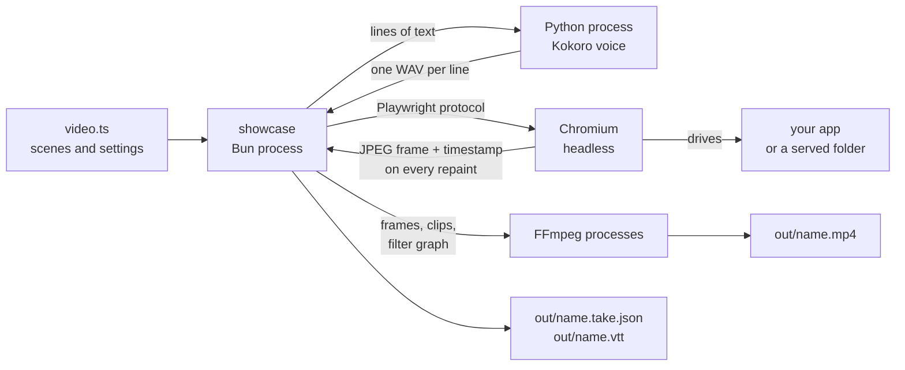
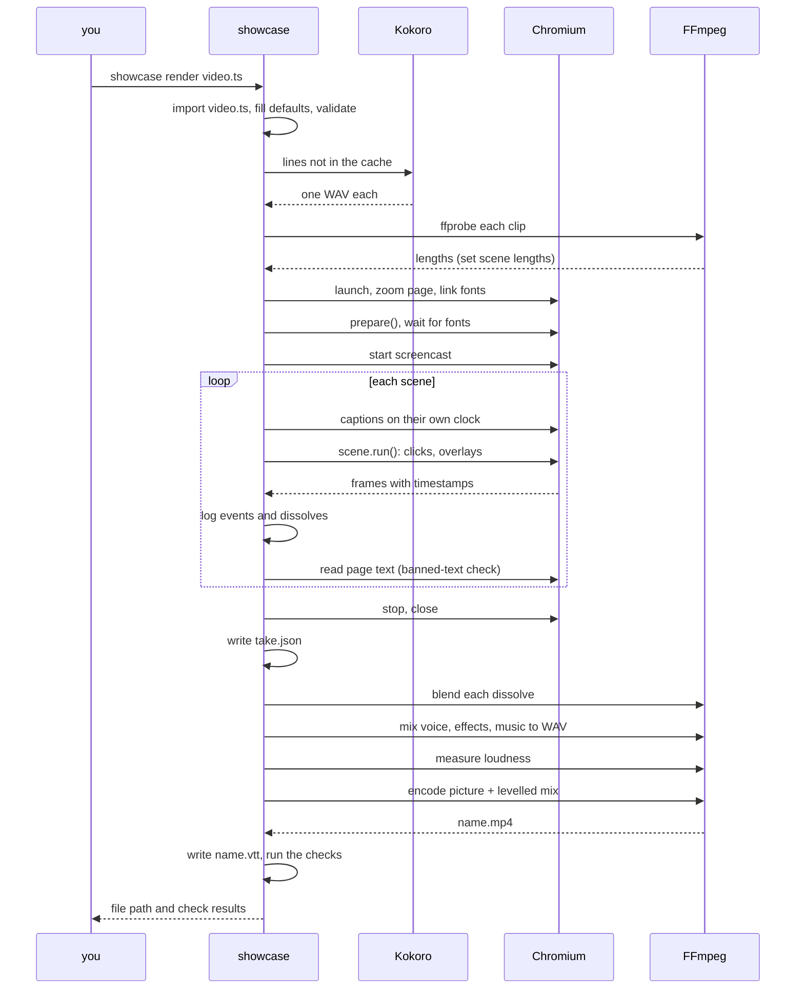
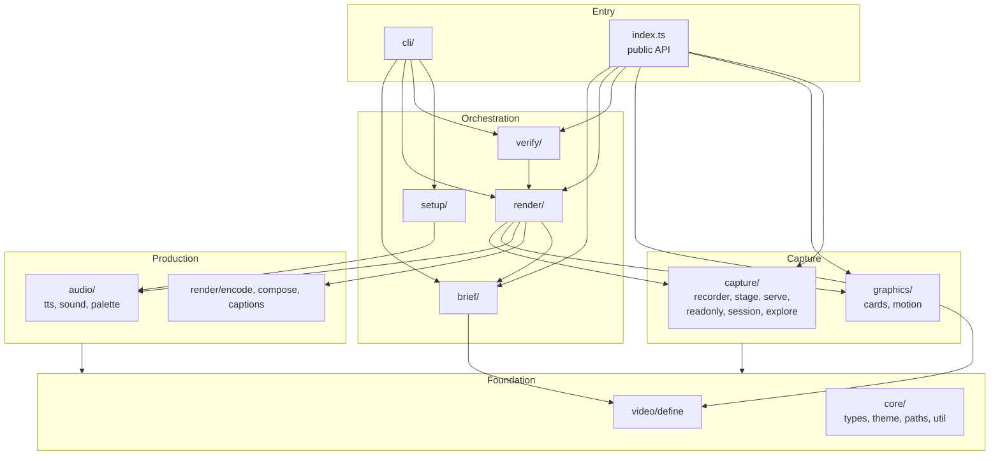
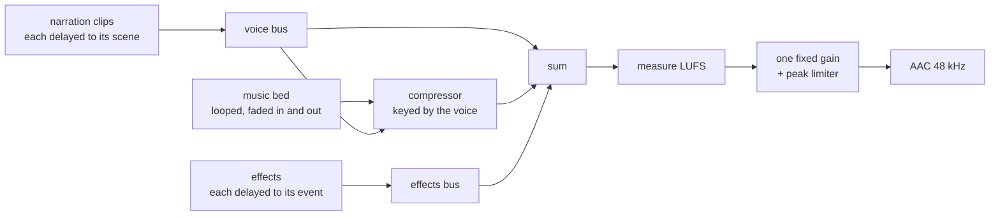

# Architecture

How the kit is put together: the processes involved, the modules, the data that flows
between them, and where it can be extended. For the pipeline told as a story, read
[How it works](how-it-works.md) first. For the tools and their versions, see
[Tech stack](tech-stack.md).

## The system in one picture



Four kinds of process take part, and only one of them is ours:

| Process | Started by | Lives for | Does |
|---|---|---|---|
| **showcase** (Bun) | you | the whole render | Everything in `src/`: orchestration, timing, logs |
| **Python** (Kokoro) | showcase, once per render | until the new lines are voiced | Text to WAV |
| **Chromium** | showcase, through Playwright | the recording | Runs the app, paints overlays, hands back frames |
| **FFmpeg / ffprobe** | showcase, several times | each a few seconds | Measures clips, makes sounds, blends dissolves, mixes, encodes |

showcase talks to the others only through their command lines, standard input and files.
Nothing is linked in, which is why each can be replaced.

## One render, step by step



## Layers

The source is one folder per layer. A folder may import from the folders below it in
this list, never from the ones above.

```
bin/showcase.js            the launcher: runs src/ under Bun, dist/ under Node
src/
  cli/                the showcase command: parse the words, call one function, print
  auto/               showcase auto: the scenes written through the Claude API
  brief/              showcase.config.json: checks, presets, plan, script, work order
  render/             the runner, the encoder, captions, framed layouts, make
  verify/             the checks
  setup/              showcase setup and showcase doctor
  capture/            everything that talks to the browser page
  graphics/           cards (HTML strings) and motion scenes (frame by frame)
  audio/              the voice, the effects, the music bed, the soundcn palette
  video/              defineVideo: defaults and early refusals
  core/               types, theme, paths, the one function that starts a process
  index.ts            the public API a video file imports
python/kokoro_tts.py  the voice script the kit runs
schema/               the JSON schema for showcase.config.json
templates/            what showcase init copies into a project
skills/               the editor skill for Claude Code
```



The rules that keep it that way:

- **core/** knows nothing about browsers or FFmpeg. `types.ts` holds every shared
  shape; `util.ts` holds the one function that starts a process; `paths.ts` finds the
  files that ship with the kit, whether the code runs from `src/` or from `dist/`.
- **capture/** and **graphics/** talk to the page. Only `graphics/motion.ts` starts
  FFmpeg, to blend the samples of a blurred frame.
- **audio/** and the encoder talk to FFmpeg and Python. They never touch the page.
- **brief/** is pure: it turns a config into ordinary video configs and text. It never
  opens a browser.
- **render/** is the only layer that knows the order of things.
- A **video file** imports only from the package name, `kwartz-showcase`.

## Modules

| Module | Responsibility | Talks to |
|---|---|---|
| `cli/index.ts`, `args.ts`, `commands.ts` | Parse the command, call one function, print, set the exit code | terminal |
| `index.ts` | The public API a video file imports | none |
| `core/types.ts` | Every shared type: `VideoConfig`, `Scene`, `Layout`, `Take`, `Frame`, `Cue`, `Dissolve` | none |
| `core/theme.ts` | Colours, font stacks, easing, card and caption scale; merge a partial theme | none |
| `core/paths.ts` | The kit's own folder and the files that ship in it | file system |
| `core/util.ts` | `run` (start a process), `sleep`, the cache folder | processes |
| `core/html.ts` | `esc`: text made safe for HTML | none |
| `video/define.ts` | `defineVideo`; fill defaults; refuse mistakes early | file system (import) |
| `brief/brief.ts` | The config type; every check on it; local or hosted | file system |
| `brief/presets.ts` | Shapes, platforms, safe areas; the layout for a shape | file system (import) |
| `brief/looks.ts` | The motion feels and the named backdrops, as plain data | none |
| `brief/themes.ts` | The themes: colours, pairing, backdrop, sound mood, and the look of every surface | none |
| `brief/theme-rules.ts` | The rules of a theme file: its shape, safe CSS, readability; a theme file as a theme. Plain logic, so the website's theme studio runs the same rules | none |
| `brief/custom-theme.ts` | Theme files of a project: reading them from disk, finding a theme by name | file system |
| `brief/fonts.ts` | The Google Fonts table, the pairings, the stylesheet address, the check before a render | network |
| `brief/plan.ts` | From a length to scenes and a word budget; advice when a render misses | none |
| `brief/script.ts` | Read a person's script and place its paragraphs on scenes | none |
| `brief/resolve.ts` | From a config to one video config per shape, with notes | file system (import) |
| `brief/workorder.ts` | The page `showcase plan` prints | none |
| `render/render.ts` | The runner: narration, browser, scene loop, take, finish, remix | capture, graphics, audio, encoder |
| `render/make.ts` | Every shape of a config: palette, render, checks, platform copies, credits | render, verify |
| `render/encode.ts` | Plan and blend dissolves; build the mix; level it; encode | FFmpeg |
| `render/border.ts` | The rounded border: backdrop, mask and shadow, and the filter that sets the picture on them | FFmpeg |
| `render/compose.ts` | Framed layouts: place frames on the canvas; draw captions as images | FFmpeg, Chromium |
| `render/captions.ts` | Split a line into captions; WebVTT | none |
| `capture/recorder.ts` | Zoom the page, await fonts, write frames with timestamps; pause for motion scenes | Chromium |
| `capture/stage.ts` | Pointer, captions, spotlight, camera, dissolves, chapters, full-screen layers | Chromium |
| `capture/serve.ts` | A static file server for `serve` | network (localhost) |
| `capture/readonly.ts` | Refuse every request that could change data | Chromium |
| `capture/session.ts` | `showcase login`: save a sign-in and keep it out of git | Chromium |
| `capture/explore.ts` | `showcase explore`: the product map | Chromium |
| `graphics/cards.ts` | HTML for hook, title, steps and end cards | none (returns strings) |
| `graphics/clip.ts` | Clip scenes: a video file made into frames on the canvas, with captions | FFmpeg, Chromium |
| `graphics/motion.ts` | Render a motion scene frame by frame, with motion blur | Chromium, FFmpeg |
| `audio/tts.ts` | Cache key per line; run Kokoro; measure clips; draft estimates | Python, ffprobe |
| `audio/sound.ts` | Effects per event kind; the generated music bed | FFmpeg |
| `audio/palette.ts` | Choose, measure and gate soundcn sounds for a project | FFmpeg, soundcn |
| `auto/auto.ts` | `showcase auto`: ask Claude for the scenes, check the file, draft, fix, render | Claude API, render |
| `auto/theme.ts` | A theme from a description: ask Claude, check the file, send back what fails | Claude API |
| `render/preview.ts` | One picture of a theme's cards and overlays in both shapes | Chromium, FFmpeg |
| `verify/verify.ts` | The checks | ffprobe, FFmpeg |
| `setup/setup.ts` | `showcase setup` and `showcase doctor` | Playwright CLI, Python, network |
| `python/kokoro_tts.py` | Text to WAV with kokoro-onnx | Kokoro model |

## The data

### Time

There is one clock: milliseconds since recording started (`Recorder.now()`). Frame
timestamps, caption cues, narration starts, sound events and dissolve marks are all on
it. That single clock is what lets the encoder place a click sound on the frame where
the click happened without anyone lining anything up.

Scene length is decided before recording, from the voice:

```
scene = lead-in (350 ms) + narration clip + pause (800 ms)
        but never shorter than its steps take to run
```

### The take

A recording produces one JSON file, `out/<name>.take.json`. It is the boundary between
the capture half and the production half of the kit.

```ts
interface Take {
  draft: boolean
  frames: { file: string; t: number }[]         // every repaint, in order
  endMs: number                                  // length of the recording
  audio: { file: string; at: number }[]          // narration clips and their start times
  cues: { text: string; start: number; end: number }[]   // captions
  events: { t: number; kind: 'click' | 'callout' | 'whoosh' }[]   // where sounds go
  dissolves: { t1: number; t2: number; ms: number }[]    // changes of screen
  seen: { id: string; text: string }[]           // page text per scene
  missingFonts: string[]
}
```

Everything after the take is a pure function of it plus the settings. That is why
`showcase remix` can change the music or the effects in seconds, and why `showcase verify` can
check a render without opening a browser.

### A dissolve, in detail

`stage.dissolve(fn)` records `t1` just before `fn` and `t2` just after. Nothing special
happens in the page: the loading state is filmed like anything else. The work is in the
encoder (`planDissolve`, `blendDissolves`):

```
recorded:   A A A A | L L L L L L L L | B B B B        L = loading, whatever was filmed
                    t1                t2
encoded:    A A A A A A A A A A A x x x B B B B        x = A blended into B, the last 380 ms
```

1. `A` is the last frame at or before `t1`; `B` is the last frame at or before `t2`.
2. Every frame between them is dropped.
3. FFmpeg's `xfade` makes the blended frames from `A` and `B`.
4. They are placed in the last `ms` before `t2`, so `A` simply holds until then.

### Files on disk

| Where | What | Kept in git |
|---|---|---|
| `<project>/video.ts` | The video | yes |
| `<project>/out/<name>.mp4`, `.vtt` | The result | no |
| `<project>/out/<name>.take.json` | The take | no |
| `<project>/out/frames-<name>/` | One JPEG per repaint | no |
| `<project>/out/blends/` | Blended dissolve frames | no |
| `<project>/out/failed.png` | The page when a render stopped | no |
| `~/.cache/kwartz-showcase/kokoro/` | The voice model (about 350 MB) | n/a |
| `~/.cache/kwartz-showcase/kokoro-venv/` | Python environment for the voice | n/a |
| `~/.cache/kwartz-showcase/audio/` | Narration clips, named by a hash of voice, speed and text | n/a |
| `~/.cache/kwartz-showcase/sfx/`, `music-pad.wav` | Effects and the music bed | n/a |

The cache is per machine and shared by every project. Set `SHOWCASE_HOME` to move it.

## The sound graph

One FFmpeg run builds the mix, a second measures it, a third applies the gain while
encoding the picture.



## Overlays and coordinates

Overlays are HTML that Playwright injects into the page (`page.screencast.showOverlay`),
so they are captured in the same frames as the app. Two facts shape `stage.ts`:

- **Zoom.** The page is zoomed, Playwright reports element boxes in window pixels, and
  overlays are laid out in zoomed pixels. Every box is divided by the zoom before an
  overlay is placed on it (`Stage.box`).
- **Stacking.** Overlays stack in the order they were created. The spotlight dims
  everything under it, so the caption is drawn again after each spotlight to stay on
  top.

The camera does not move a viewport. It applies a CSS `transform: scale()` to the app's
root element, with the origin on the target, so the target stays put and everything
around it grows. Overlays are outside that element and keep their size. The transform
is removed when the camera returns, because a transformed ancestor changes where
fixed-position elements (drawers, dialogs) anchor.

## Where to extend

| To add | Change |
|---|---|
| A new card | A function in `graphics/cards.ts` that returns HTML; export it from `index.ts` |
| A new stage move | A method on `Stage`; log an event if it should make a sound |
| A new sound for an event | An entry in `SFX` in `audio/sound.ts`, and the kind in `EventKind` |
| Another voice engine | A function with the shape of `narrate` in `audio/`, chosen by a `voice.engine` setting |
| A new check | A `Check` pushed in `verify/verify.ts`; keep the logic in a pure function with a test (see [Testing](testing.md)) |
| Another transition | A filter other than `xfade=fade` in `blendDissolves` |
| A new shape or platform | An entry in `FORMATS` or `PLATFORMS` in `brief/presets.ts` |
| A new config setting | The `Brief` type and `validateBrief` in `brief/brief.ts`, the schema, and where it lands in `brief/resolve.ts` |
| A new sound role or limit | `ROLES` in `audio/palette.ts` |
| A new output kind (GIF) | A second encode in `finish` |

## What is deliberately not here

- **No timeline editor and no project format.** The video file is the project.
- **No bundled media or models.** Everything large is downloaded once into the cache.
- **No cloud service.** A render works offline once set up, apart from fonts in the
  default theme.
- **No bundler.** Under Bun the TypeScript runs as it is. For Node and for npm, `bun run build` compiles `src/` to `dist/` with the TypeScript compiler alone; see Packaging.
- **No word-level caption timing.** The voice model does not report it; captions are
  timed by their share of the text.

## Motion scenes on the timeline

An app scene is filmed in real time. A motion scene is rendered off screen, as slowly
as the machine needs. Both must sit on one clock.

1. The runner calls `Recorder.pause()`: the clock stops and the browser's frames are
   ignored.
2. `renderMotion` opens a second page the size of the canvas, pauses every animation,
   sets each to an exact time and takes a screenshot per frame. With blur on, four
   samples from the half frame before are blended into each moving frame.
3. `Recorder.insert()` puts those frames on the timeline at the scene's start, and
   `Recorder.resume(durationMs)` starts the clock again exactly one scene later.

## Framed layouts

In a `framed` or `fit` layout the filmed page is smaller than the video.

- `layout.width` and `height` are the filmed window; `layout.canvas` is the video.
- `composeFrames` places every filmed frame in its window on the canvas, in one FFmpeg
  run. Motion frames are already canvas size.
- Captions are not drawn in the page. Each is rendered once as a transparent image the
  size of the caption band, and the encoder lays a timed list of them over the picture.
- The encoder reads its frames with filter re-initialisation off. Filmed and drawn
  frames differ slightly as files; if the filter graph is rebuilt where they meet, the
  caption track is lost from that point on.

## The rounded border

The border is the last step of the picture filter. Two still pictures are drawn once
per render with FFmpeg alone: a grey mask of the rounded picture, and the backdrop
with the shadow already on it. The encoder then scales the finished picture (captions
included), gives it the mask as its transparency, and lays it on the backdrop. Because
nothing about it is recorded, a remix can change it.

## Packaging

The repo is laid out so the same tree serves a clone, an npm package and a container.

| Consumer | Entry | Runs |
|---|---|---|
| A clone or a linked copy, under Bun | `bin/showcase.js` | `src/` as TypeScript |
| An npm install, under Node 22.18 or later | `bin/showcase.js` | `dist/`, built by `bun run build` |
| A video file | `import ... from 'kwartz-showcase'` | `src/` under Bun, `dist/` under Node (package `exports`) |

- Everything that is not TypeScript and must ship (the Python voice script, the schema,
  templates, the skill) lives at the package root and is found through `core/paths.ts`,
  so it needs no copy step in the build.
- The cache (browser aside) is one folder, `SHOWCASE_HOME`, default
  `~/.cache/kwartz-showcase`: the voice model, the Python environment, narration clips,
  downloaded sounds. In a container it is the one volume to mount.
- A project's own state is in two folders beside its config: `.showcase/` (working files)
  and `out/` (results). A container needs only the project folder mounted.
- System needs for an image: FFmpeg, Python 3.10 to 3.13, and the libraries Chromium
  needs (`playwright install --with-deps chromium`).

No container file ships yet; this section records what one needs.
